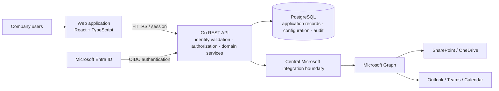

# System architecture

**Status:** Proposed architecture based on the agreed technology baseline.

## Logical view

Reporting is provided by in-application dashboards computed from PostgreSQL; Power BI is out of scope (see ADR 0005). The diagram represents a logical integration boundary, not a committed deployment topology.

## Responsibilities

| Component | Responsibility |
| --- | --- |
| `web/` | User interface, route-level access presentation, forms and API client. It is not an authorization authority. |
| `api/` | Identity/session handling, authorization, validation, domain rules, workflow execution, audit creation and integrations. |
| PostgreSQL | System of record for df-pmp business records, configuration and audit metadata. |
| Entra ID | Company identity authentication and identity claims. Detailed business permissions remain in df-pmp. |
| Microsoft integration | Encapsulated Graph/API clients, credential flows, resource mapping, synchronization and retry behavior. |
| SharePoint/OneDrive | Company-managed document contents and document lifecycle, subject to approved integration. |

## Key request flow

1. A user signs in through the approved Entra ID flow.
2. The API validates the identity using tenant and issuer configuration, then resolves the df-pmp user.
3. The API evaluates current roles, permissions, assignments and resource scope for each request.
4. Domain services validate business transitions and persist changes transactionally.
5. Audit events are recorded for required actions. External work is performed through the integration boundary and records stable external identifiers.

A Backend-for-Frontend (BFF) session with secure, HTTP-only cookies is the preferred option to evaluate. Final choice between BFF and direct SPA authorization-code-with-PKCE depends on security architecture review and Entra tenant requirements.

## Deployment view

Development may use Docker Compose with web, API and PostgreSQL services. The database should be reachable only on a private service network. Production ingress, TLS termination, secrets, image registry, database hosting, monitoring, backup, environment separation and container limits must use bank-approved infrastructure. Redis, a background worker and centralized telemetry are optional future components justified by operational needs.

## Modularity

The API should be organized around cohesive domains (identity, authorization, administration, projects, tasks, meetings, workflows, integrations and audit). Modules should depend on explicit interfaces rather than calling each other's persistence directly. Workflow configuration must have validation and versioning controls. This is a design direction, not a mandate to create a distributed microservice system.

## Trust boundaries

- Browser to ingress/API: untrusted client; validate all input and enforce authorization server-side.
- API to PostgreSQL: private service boundary; least-privileged database identity and parameterized operations.
- API to Microsoft: outbound integration boundary; distinct delegated/application permissions and secret/certificate handling.
- Reporting: approved data exposure boundary; define row-level access, export restrictions and refresh ownership.
