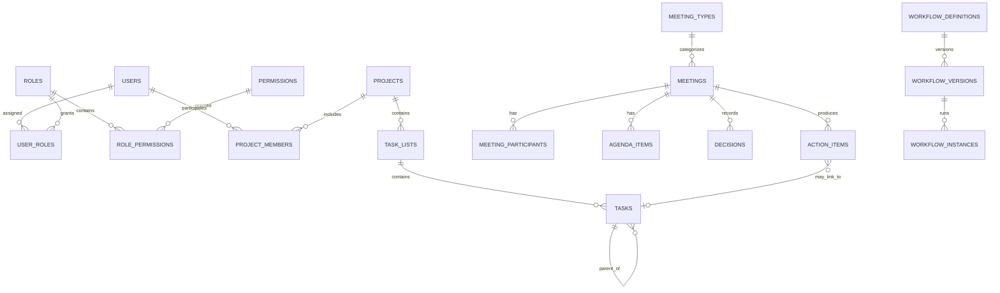

# Domain and database design

**Status:** Conceptual proposal. This is not a finalized physical schema or migration plan.

## Design guidelines

- Use PostgreSQL as the authoritative store for df-pmp records and configuration.
- Use stable primary keys and foreign keys; define uniqueness, nullability and deletion behavior deliberately.
- Keep Microsoft document contents in SharePoint/OneDrive. Store references and synchronization metadata, not duplicate file bodies.
- Separate configurable business data from code-defined technical invariants. Validate configurations before activation.
- Include created/updated timestamps and actor references where appropriate. Keep a distinct append-oriented audit history for security-relevant events.
- Define data classification, retention, archival and deletion behavior with bank policy owners before finalizing columns.

## Proposed domains and entities

| Domain | Candidate entities | Notes |
| --- | --- | --- |
| Identity | `users`, `departments`, `user_profiles` | User keyed to Entra subject/tenant identifiers; email is an attribute, not identity proof. |
| Authorization | `roles`, `permissions`, `role_permissions`, `user_roles`, `role_scopes`, `user_scope_assignments` | Configurable grants and scoped assignments; exact scope model remains open. |
| Projects | `projects`, `project_members`, `project_statuses` | Status values and required metadata may be configurable. |
| Tasks | `task_lists`, `tasks`, `task_assignments`, `task_dependencies` | A task can reference a parent task for subtasks; dependency semantics need definition. |
| Meetings | `meeting_types`, `meetings`, `meeting_participants`, `agenda_items`, `minutes`, `decisions`, `action_items` | Meeting type configuration should not require code changes for routine additions. |
| Workflow | `workflow_definitions`, `workflow_versions`, `workflow_steps`, `workflow_transitions`, `workflow_instances`, `workflow_events` | Keep published versions immutable; define active-instance upgrade rules. |
| Integration | `external_resources`, `document_links`, `sync_records` | Store provider, tenant/site/drive/item IDs, resource type and sync state as needed. |
| Governance | `audit_logs`, `change_history`, `notifications` | Distinguish durable audit evidence from user-facing notifications. |

## Conceptual relationships

The diagram is conceptual; it does not settle join-table keys, cardinality constraints, tenant partitioning, or physical naming conventions.

## Important modeling questions

- Is the organizational hierarchy a department-only structure, or are branches, teams, cost centers or legal entities needed?
- Can a task have multiple assignees and dependencies? Are dependencies blocking, informational or typed?
- Are minutes and decisions versioned/approved records, and what constitutes a final signed-off record?
- Can action items exist independently of meetings or link to more than one project/task?
- Are statuses and priorities globally configurable, per module, or per workflow?
- What personal, financial, confidential or regulated data may appear in project and meeting records?
- What retention, archival, anonymization and legal-hold rules apply?

## Audit data shape (candidate)

An audit event should capture event ID, timestamp, actor subject/user, action, object type and identifier, outcome, request/correlation ID, and a carefully scoped change summary. Avoid storing access tokens, secrets, unnecessary sensitive payloads, or full before/after documents by default. Tamper resistance, retention and privileged access to audit records require security policy decisions.
